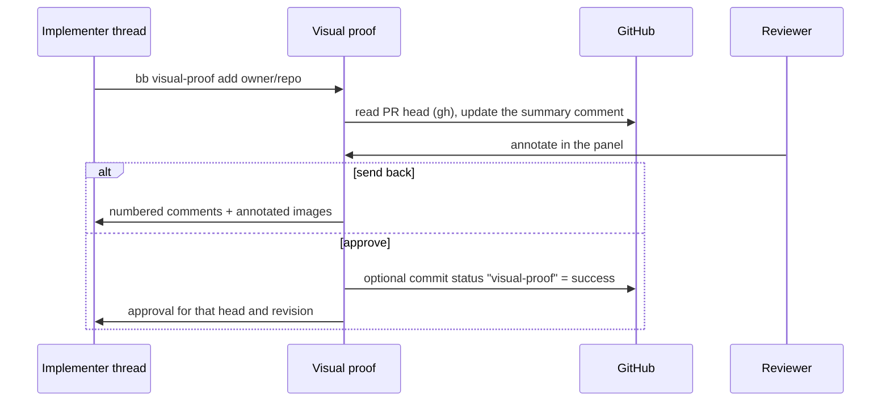

# Visual proof for BB

A BB plugin that keeps a pull request's screenshots and screencasts in BB
instead of git. Every proof belongs to exactly one PR and its head SHA. A
reviewer opens it in the **Visual proof** panel, marks places in an image or a
screencast, and either sends it back to the implementer thread with comments or
approves it.

The repository also ships two agent skills with the plugin:

- [`skills/visual-proof`](skills/visual-proof/SKILL.md): how an agent uploads,
  exports and reads proof with the `bb visual-proof` CLI.
- [`skills/prove`](skills/prove/SKILL.md): the BB-bound `prove` workflow. It
  decides which evidence a PR needs, captures it, publishes visual evidence to
  this plugin and writes the PR body (Summary, Evidence, Merge Danger).

A variant of `prove` without any BB dependency lives in the separate
`mpsoftware/skills` repository.

## Install

Requires BB 0.43 or later.

```bash
bb plugin install git:https://github.com/mpsoftware/bb-visual-proof.git@main
```

Or from a local checkout:

```bash
git clone https://github.com/mpsoftware/bb-visual-proof.git
cd bb-visual-proof
npm ci && npm run build
bb plugin install . --yes
```

## What it does

- **Upload** (agent): `bb visual-proof add owner/repo#123 <files|directory>`.
  The plugin reads the PR head through `gh`, checks file type (by content) and
  size, and reads the files on the machine of the calling thread.
- **Export** (cross-reviewer): `bb visual-proof export owner/repo#123 <directory>`
  writes every original media file and `manifest.json` to the machine of the
  calling thread through the SDK file API. It checks the current PR head;
  outdated sets need an explicit `--sha <sha>`, and historical exports do not
  re-check the head. Existing files are never overwritten and expired media fail
  the export. Relative paths resolve against the working directory; outside a
  thread, pass `--machine` and an absolute path. Only exit code 0 confirms a
  complete export; a write error can leave partial media files behind.
- **Outdated:** an upload for a new head makes older sets outdated and
  read-only. "Check head" and every approval read the current head; if it moved,
  the set becomes outdated and the approval is refused.
- **Annotate:** drag a box on a screenshot (or use the keyboard, with the
  position in percent), comment a moment in a screencast, or write a general
  comment.
- **View and zoom:** the file sits in a fixed-height stage, so nothing jumps when
  switching between portrait and landscape. Zoom happens in place: `+`/`−`,
  pinch and Ctrl/⌘ + wheel zoom up to 800 %; the plain wheel zooms only after a
  click into the image (otherwise it scrolls the panel). "Whole image" and
  "Actual size 1:1" reset the level; every file starts as the whole image. Keys: `0` whole image, `1` original size,
  `←`/`→` switch file, `↑`/`↓` and Shift+`←`/`→` pan. Markers are stored in
  percent of the image and stay aligned at every level. The viewer starts in
  "Pan" mode (drag pans, a click enables the wheel); in "Mark" mode a dragged or
  clicked area opens the comment field. Two fingers zoom in both modes.
- **Language:** the panel speaks English or German. `auto` follows the browser
  language (otherwise English); the "Panel language" setting pins it. Date and
  number formats follow the same language. Thread messages, the PR comment and
  the CLI stay English.
- **Send back ("Reject"):** a message to the implementer thread with numbered
  comments and annotated images (drawn in the browser; for screencasts, the
  frame at that moment). State "changes requested", next round.
- **Approve:** covers exactly the checked head and the revision the panel showed.
  If files or comments arrive in the meantime, the approval is refused. Unsent
  comments travel along as non-blocking remarks.
- **Delivery:** every decision is stored with a frozen message. If delivery
  fails, the panel shows it and redelivers on request or every 10 minutes,
  without sending twice.
- **PR comment:** the plugin maintains exactly one comment (marker
  `<!-- bb-visual-proof -->`) with a summary and a link into the panel.
- **Commit status (optional, off by default):** `visual-proof` = `success` on
  approval, `failure` on send-back, `pending` when new files clear a decision.
  The context name is a stable contract that a merge guard can read.



## Storage and retention

Media are stored content-addressed (SHA-256) in the plugin's data directory next
to `data.db`; metadata lives in the plugin's SQLite database. Limits: images
10 MB, videos 25 MB (BB's read limit for host files), 60 files and 200 MB per
set, 2 GB quota (configurable). Media of approved sets are deleted after 90
days, media of outdated sets after 14 days (both configurable); an open set of
the current head never expires. SHA, decision, comments, history and thumbnails
stay as an audit trail. The panel creates thumbnails in the browser on first
display.

## Settings

| Setting | Default |
| --- | --- |
| Post the `visual-proof` commit status | off |
| Keep media of approved proofs (days) | 90 |
| Keep media of outdated proofs (days) | 14 |
| Storage quota (GB) | 2 |
| Panel language (`auto`, `en`, `de`) | `auto` |

Links in thread messages and the PR comment need a configured BB app URL
(`BB_APP_URL`); without it they describe the way to the panel.

## Development

```bash
npm ci
npm run typecheck
npm test
npm run build
```

`npm test` runs the plugin tests (Vitest) and the `prove` script tests
(`node --test`). The [contract](docs/contract.md) describes the CLI, RPC, HTTP
endpoints, states and messages. `tests/proof/shoot.mjs` renders the panel against
the real server on the SDK fake host and writes screenshots to a temporary
directory (`PROOF_OUT_DIR` overrides it); it needs a local `playwright-core`
(`PLAYWRIGHT_CORE=/path/to/playwright-core/index.mjs`).

## License

[MIT](LICENSE)
