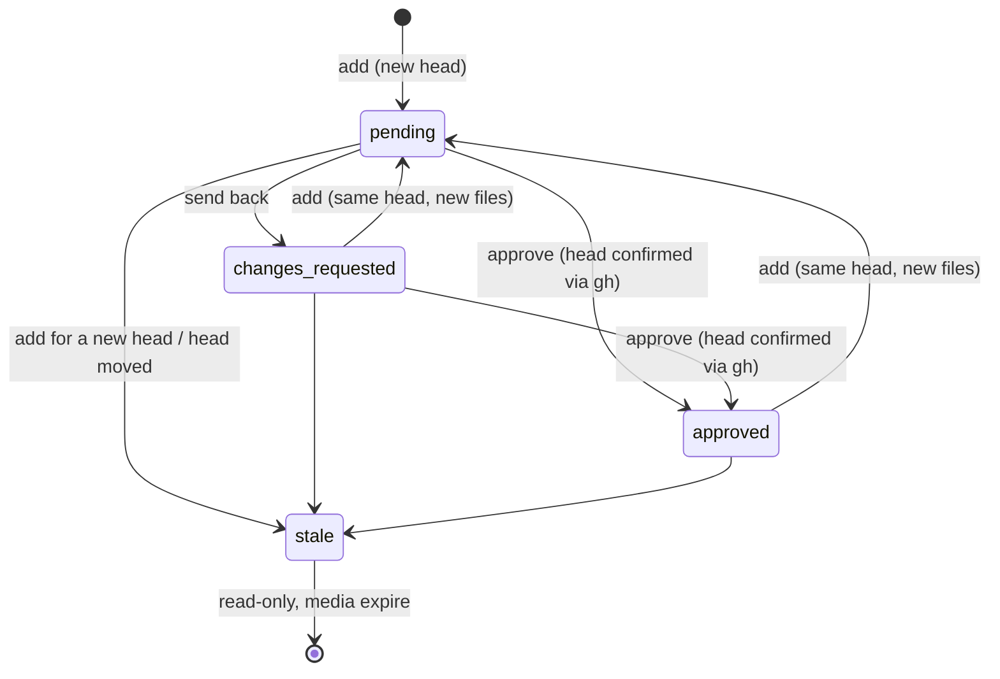

# Visual proof contract

The plugin id is `visual-proof`. RPC methods use the typed contract `rpcContract`
from `server.ts`; the data types live in `src/contract.ts`.

## Keys and states

A **set** (`ProofSet`) is identified by `repository` (lower case, `owner/name`),
`number` (the PR) and `headSha` (40 hex characters).

| Field | Meaning |
| --- | --- |
| `status` | `pending` (review open), `changes_requested` (sent back), `approved`. |
| `stale`, `staleReason` | Outdated and read-only. `superseded`: proof was uploaded for a newer head. `head_moved`: `gh` reported a different head without a new upload. |
| `currentHeadSha` | Last known head of the PR. |
| `round` | Starts at 1 and increases with every send-back. |
| `revision` | Increases with every change a decision covers: new files, comments, state changes. Send-back and approve name the revision the panel showed; if it changed (including during the head check), the decision is refused and nothing is sent. |
| `githubStatus` | `{ wanted, posted, error }`: the commit status the set should show (`success`, `failure`, `pending`), the status last posted, and the last error. |
| `threadId` | Implementer thread: the uploading thread or `--thread`. |
| `hostId` | Machine of the upload; later `gh` calls run there while it is connected. |
| `mediaExpiresAt` | Outdated: `staleAt` + outdated retention. Otherwise approved: `decidedAt` + approved retention. Otherwise `null`. |

Transitions:



**File** (`Asset`): `sha256`, `kind` (`image`/`video`), `mime`, `bytes`,
`caption`, `filename`, `position`, `hasThumbnail`, `expired`.

**Comment** (`Annotation`): `number` per set, `assetId` (`null` = the whole
set), `anchor` = `{ kind: "rect", x, y, w, h }` (fractions 0–1, images only),
`{ kind: "time", ms }` (videos only) or `{ kind: "none" }` (only without a file).
`locked` marks comments that belong to a stored decision; they are immutable.
`sent` becomes true only once the message of that decision has been delivered.
`delivery` names the state of that delivery: `pending`, `sent`, `failed` or
`no_recipient` (approval without a known implementer thread: decided, but
delivered to nobody; never `sent`). When upgrading from the first schema version,
remarks of an approval without an implementer thread are set to `no_recipient`;
sent-back comments with a thread stay `sent`. Comments can only be created,
changed or deleted on open sets, not on outdated or approved ones.

**Delivery** (`Delivery`): `kind` (`send_back`/`approval`), `revision`, `status`
(`pending`, `sent`, `failed`), `error`. Every decision creates exactly one
delivery with frozen text and image paths.

## CLI

```text
bb visual-proof add <owner/repo#N | PR-URL> [--sha <sha>] [--thread <id>] [--machine <host-id>] [--no-comment] [--json] [--caption <text>] <file|directory> ...
bb visual-proof status <owner/repo#N | PR-URL> [--json]
bb visual-proof list [--repo <owner/repo>] [--done] [--json]
bb visual-proof export <owner/repo#N | PR-URL> <directory> [--sha <sha>] [--machine <host-id>] [--json]
```

`add` requires an open PR. Paths are read on the machine of the calling thread
(`bb.sdk.files.read` with its `hostId`); relative paths resolve against its
working directory. A directory contributes its media files and those one level
down. An upload is atomic: every check (type, size, outdated head, file count,
set size, quota) runs before the first write; if anything fails afterwards, the
plugin immediately removes the files this upload created. Media shared with other
sets stay untouched. When new files reopen a decided set, the plugin sets the
commit status to `pending` (when enabled).

`export` uses the existing sets and files without new tables or RPCs. Without
`--sha` it checks the PR head via `gh`, updates the last known head and refuses
outdated sets. `--sha` selects exactly one set by a full SHA or an unambiguous
prefix (7–40 hex characters), including outdated sets and without a new GitHub
check. Missing sets or expired media are errors.

The original media are read on the server and written on the target machine
through `bb.sdk.files.write` with `contentEncoding: "base64"`,
`createParents: true` and `expectedSha256: null`. The target is the machine of
the calling thread, or `--machine`; relative target paths resolve against
`ctx.cwd`. A numeric prefix and sanitized names prevent collisions and path
traversal. Content is checked against SHA-256 and size before writing.

`manifest.json` is written last, as UTF-8. It contains `repository`, `number`,
`setId`, `headSha`, `status`, `stale`, `currentHeadSha` and `files`: per file
`file` (export name), `filename` (original name), `caption`, `sha256`, `kind`,
`mime`, `bytes`. `--json` returns these fields plus `directory` and
`manifestPath`, without media content. A write error or an existing target file
returns exit code 1; partial media may remain, and existing files including the
manifest are never overwritten. Only exit code 0 confirms a complete export.

## RPC

| Method | Input | Effect |
| --- | --- | --- |
| `proofs_list` | `{ repository?, view: "open" \| "done" }` | Newest set per PR. `done` = approved and current. Plus counters, repositories and storage use. |
| `proofs_detail` | `{ repository, number, setId? }` | Set (default: newest), files, comments, events, history of all heads. |
| `proofs_check_head` | `{ repository, number }` | Reads the head via `gh`; marks the newest set as `head_moved` on a mismatch. |
| `proofs_annotation_add` / `_update` / `_delete` | Comment | Only on sets that are neither outdated nor approved; only unsent comments can change. |
| `proofs_stage_render` | `{ setId, dataBase64 }` | Accepts an annotated image (PNG/JPEG/WebP, at most 2 MB) for the next send-back; in memory only, for 10 minutes. |
| `proofs_send_back` | `{ setId, revision, renderIds }` | Stores the send-back for exactly this revision: open comments become `locked`, state `changes_requested`, round + 1, a delivery with frozen text and at most 10 images. Then delivers to the thread. |
| `proofs_approve` | `{ setId, revision, note }` | Checks the head via `gh`; on a mismatch refuses and marks `head_moved`. Refuses if the revision changed. Otherwise `approved` and delivery to the thread. |
| `proofs_retry` | `{ setId }` | Redelivers failed or stuck deliveries and posts a pending commit status. |
| `proofs_thumbnail_put` | `{ assetId, dataBase64 }` | Thumbnail (at most 96 KB), kept permanently. |
| `proofs_delete_media` | `{ setId }` | Deletes the media of an outdated or approved set immediately. |
| `proofs_pending_count` | `null` | Number of open sets for the sidebar badge. |

After storing a decision, the plugin delivers the message, updates the PR
comment and optionally posts the commit status. Failures come back as
`warnings`; the decision stays stored. The `delivery-sweep` schedule retries open
deliveries and statuses every 10 minutes; the panel offers "Redeliver now".

Realtime: channel `visual-proof-changed` with `{ pendingCount }` after every change.

## HTTP

`GET /api/v1/plugins/visual-proof/http/media?sha=<sha256>` returns a file with
the stored type detected from magic bytes, `X-Content-Type-Options: nosniff`,
`Content-Security-Policy: default-src 'none'; sandbox` and byte ranges (for video
seeking). `…/thumb?sha=<sha256>` returns the thumbnail. Both use BB's standard
`local` auth.

## Messages to the implementer thread

Every delivery carries the marker `[visual-proof:<deliveryId>]`. Before each
send, the plugin looks for it in the thread's queue and history; after a lost
acknowledgement nothing is sent twice, and a retry sends exactly the frozen
text. A second approval of the same head (after new files) is a new delivery
with a new marker.

- Send-back: `Visual proof sent back for rework [visual-proof:<deliveryId>]`
- Approval: `Visual proof approved [visual-proof:<deliveryId>]` with the approved revision

Comments appear as quotes, marked as review feedback.

## Commit status

Context `visual-proof` on the set's `headSha`, target URL = panel link, only
when the setting is enabled (default: off):

| State | When |
| --- | --- |
| `success` | Approval stored. |
| `failure` | Send-back stored. |
| `pending` | New files cleared an approval or send-back of the same head. |

If posting fails, the wanted status stays stored, the panel shows the error and
the schedule retries. A `success` holds only while no newer wanted status is
pending. The context name is stable, so a merge guard can read it.
